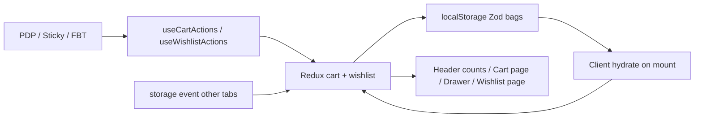
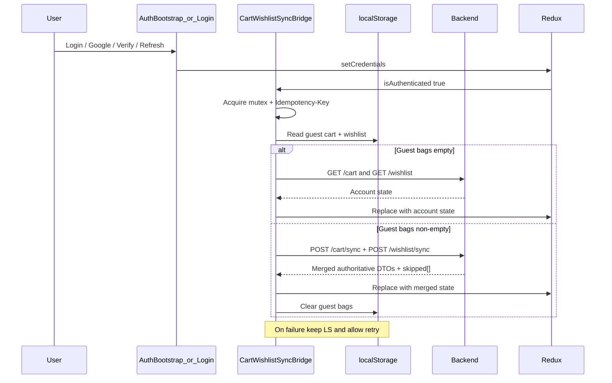
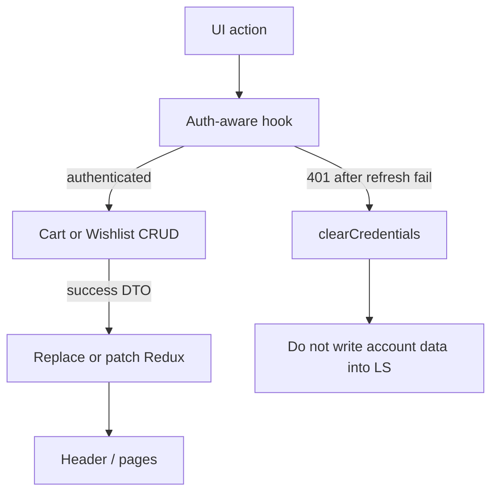
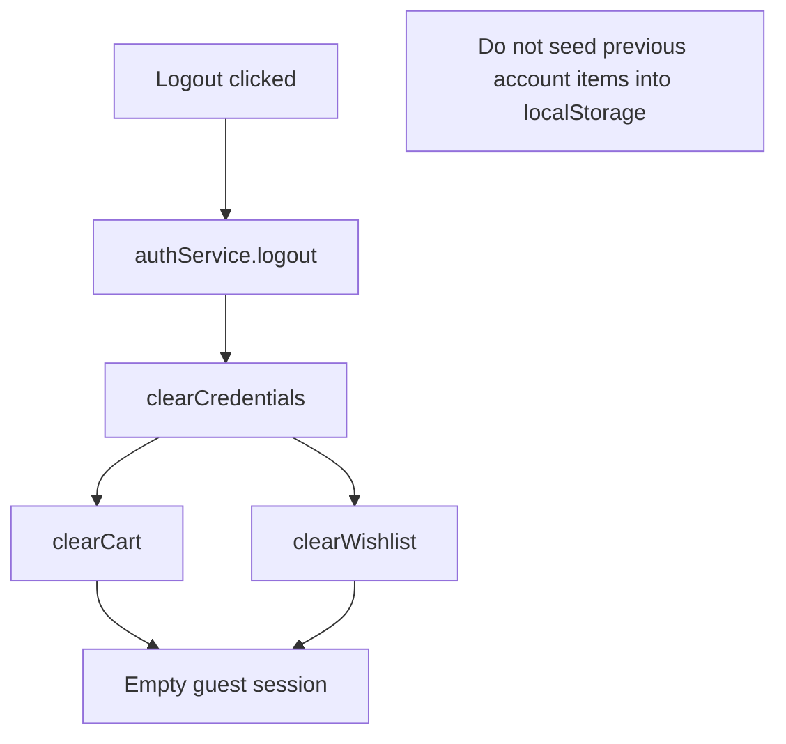

# Dynamic Guest Cart & Wishlist Sync — Implementation Plan

> **Status:** Analysis and planning only. This document is the deliverable of a repository audit. It does **not** implement the feature.
>
> **Scope:** `.in` storefront (`frontend/`) + shared `backend/`. Admin and a future `.com` app are out of scope for ecommerce cart/wishlist.
>
> **Created:** 2026-04-13 (audit against the live repository).

---

## Locked architectural decisions

These decisions are fixed for the future implementation task so it does not re-litigate the audit:

| Decision | Choice |
|----------|--------|
| Guest persistence | Browser `localStorage` only (product/variant IDs + cart quantities). No guest cart rows in PostgreSQL. |
| Authenticated persistence | Existing Prisma `Cart` / `CartItem` and `Wishlist` / `WishlistItem` (user-owned). |
| Frontend state | Keep Redux Toolkit. Do not introduce Zustand, React Query-as-cart-store, or another state library. |
| Cart line identity | `(productId, variantId)` — matches `@@unique([cartId, variantId])`. |
| Cart merge | Sum guest + account quantities per variant, then **cap** at available stock (`quantityOnHand - quantityReserved`). Skip invalid/inactive/non-`IN` products. Never trust client prices or totals. |
| Wishlist merge | Union by `productId` (schema unique). Skip invalid. Existing duplicates are no-ops (idempotent). |
| Sync trigger | Single root `CartWishlistSyncBridge` after confirmed auth (login, Google, email verify, `AuthBootstrap` restore). Do not duplicate sync inside each login form. |
| Clear guest storage | Only after backend confirms merge **and** the frontend applies the authoritative response. |
| Guest wishlist UX | Public storefront route `/wishlist` (footer already links here). Account portal may keep `/account/wishlist` as the same view or redirect. |
| Logout | Clear Redux cart/wishlist. Do **not** copy account data into guest `localStorage`. |
| Prisma schema | No guest-table migration required for the localStorage guest approach. Optional indexes only if profiling demands them. |

---

## A. Executive summary

### Current state

- **Cart UI** (page, drawer, quantity stepper, header badge) is implemented against **client-only Redux**.
- **Cart Redux** seeds a **demo sample line item** and a demo coupon on every fresh store. There is **no** `localStorage` persistence and **no** cart API client.
- **Backend cart** is a **scaffold**: `GET /api/v1/cart/status` returns `{ ready: false }`. Prisma `Cart` / `CartItem` models exist but have no CRUD service.
- **Wishlist API** is **implemented** for authenticated `CUSTOMER` users (`GET` / `POST` / `DELETE`), with IN-site product checks on add and ownership checks on remove.
- **Wishlist UI** lives under the account portal behind `RequireAuth` (`/account/wishlist`). Guests cannot use wishlist without signing in. The Redux `wishlistSlice` is wired into the store but **unused** by UI.
- **PDP** adds to cart via Redux and adds to wishlist via API (auth-only, add-only, not a toggle).
- **Login / Google / verify / session restore** set credentials but do **not** merge guest cart/wishlist.
- **Logout** clears auth credentials but does **not** clear cart/wishlist Redux state.

### Desired behavior

1. Guests browse and manage cart/wishlist without signing in; state persists in `localStorage` across navigation and refresh.
2. Authenticated customers persist cart/wishlist in the account via the backend (cross-device).
3. After login, registration verification, Google sign-in, or session restore, guest cart and wishlist sync to the account in the background, merge deterministically, update UI from the server response, then clear guest storage only on success.
4. Failed sync preserves guest data and allows safe retry. Duplicate sync from React Strict Mode or multiple mounts must not double-count cart quantities.
5. Navbar counts, cart page, wishlist page, drawer, and PDP actions share one source of truth per auth mode.
6. Order amounts remain server-authoritative at checkout; never trust browser-supplied totals.

### Main architectural decisions

Reuse Redux + existing wishlist API; implement cart CRUD + dedicated sync endpoints; guest bags stay client-side until auth; one sync bridge owns merge orchestration; hydrate after mount to avoid Next.js SSR/localStorage mismatches.

---

## B. Repository findings

### Project structure (verified)

| Path | Role |
|------|------|
| `frontend/` | `.in` ecommerce storefront (cart, wishlist, customer auth, PDP, checkout UI) |
| `backend/` | Shared Express + TypeScript API and Prisma/PostgreSQL |
| `admin/` | Admin Next.js app (site-scoped catalog; **no** customer cart) |
| `docs/` | PRD, architecture, API contract, database, security, testing |
| `.cursor/rules/project.mdc` | Repository implementation rules |
| `apps/` | **Does not exist** (docs mention aspirational `apps/*`; actual layout is top-level folders) |
| `.com` Next app | **Not present yet** (corporate site is future work) |

Cart and wishlist ecommerce behavior belongs only on the `.in` storefront (`frontend/`).

### Documentation inspected

| Document | Relevant findings |
|----------|-------------------|
| `docs/ARCHITECTURE.md` | Redux for cart UI / session UI; centralized Axios; feature modules under `backend/src/features` including `cart/` and auth |
| `docs/DATABASE.md` | `Cart` / `CartItem` described under guest/customer-cart policy (policy still open in docs). Wishlist models exist in Prisma but are under-documented here |
| `docs/API_CONTRACT.md` | Wishlist endpoints documented. Cart listed as retrieve/update with “Customer or supported guest-cart mechanism” but **no concrete CRUD contract** yet |
| `docs/SECURITY.md` | Access JWT + HttpOnly refresh; no refresh in `localStorage`; customer must not read another customer’s cart |
| `docs/TESTING.md` | Cart operations, ownership, guest vs customer endpoints called out as coverage areas |
| `docs/DO_AND_DONT.md` | Centralize Axios; don’t store long-lived tokens in `localStorage`; no interceptor toasts |
| `docs/PRD.md` | Guest may add to cart “if enabled”; customer cart/wishlist; guest checkout still an open decision |
| `.cursor/rules/project.mdc` | Shared backend; site scope; Zod; goey-toast; Jest + Supertest for new routes |

### Frontend files inspected (cart / wishlist / auth / products)

| File | Responsibility |
|------|----------------|
| `frontend/src/app/(storefront)/cart/page.tsx` | Cart route shell |
| `frontend/src/components/cart/cart-page-view.tsx` | Cart page UI over Redux |
| `frontend/src/components/cart/cart-drawer.tsx` | Sheet cart over Redux |
| `frontend/src/components/cart/quantity-stepper.tsx` | Shared quantity control |
| `frontend/src/components/cart/cart-ui-context.tsx` | Drawer open/close only (not cart data) |
| `frontend/src/components/layout/header-cart-button.tsx` | Cart count badge + open drawer |
| `frontend/src/components/layout/site-header.tsx` | Wishlist heart link (no count) |
| `frontend/src/components/layout/storefront-shell.tsx` | Mounts `CartUiProvider` + `CartDrawer` |
| `frontend/src/store/slices/cartSlice.ts` | Cart Redux + **demo seed** |
| `frontend/src/store/slices/wishlistSlice.ts` | Unused `itemIds` shell |
| `frontend/src/store/index.ts` | `auth`, `cart`, `wishlist`, `user` slices |
| `frontend/src/store/provider.tsx` | Per-mount `makeStore()`; no persist middleware |
| `frontend/src/hooks/useCartTotals.ts` | Client subtotal / discount / gift wrap / item count |
| `frontend/src/types/cart.ts` | `CartItem`, totals, extras types |
| `frontend/src/app/(storefront)/account/(portal)/wishlist/page.tsx` | Account wishlist route |
| `frontend/src/app/(storefront)/account/(portal)/layout.tsx` | Wraps portal with `RequireAuth` |
| `frontend/src/components/account/wishlist-page-view.tsx` | API-backed wishlist list/remove |
| `frontend/src/components/account/wishlist-page-view.test.tsx` | Empty-state unit test |
| `frontend/src/features/wishlist/wishlist.service.ts` | `get` / `add` / `remove` Axios calls |
| `frontend/src/features/wishlist/wishlist.types.ts` | Wishlist DTOs |
| `frontend/src/components/product/product-detail-view.tsx` | PDP composition |
| `frontend/src/components/product/product-purchase-panel.tsx` | Add to cart (Redux) + wishlist add (API) |
| `frontend/src/components/product/product-sticky-bar.tsx` | Sticky add to cart (Redux) |
| `frontend/src/components/product/frequently-bought.tsx` | Bundle add to cart (Redux) |
| `frontend/src/components/landing/product-card.tsx` | Link card; no cart/wishlist CTAs |
| `frontend/src/features/products/product.service.ts` | Public product fetch by slug |
| `frontend/src/app/(storefront)/products/[slug]/page.tsx` | PDP route |
| `frontend/src/services/api/endpoints.ts` | `CART.*` placeholders; live `WISHLIST.*` |
| `frontend/src/services/api/axios.ts` | Central client; Bearer + cookie refresh |
| `frontend/src/services/api/token-store.ts` | In-memory access token only |
| `frontend/src/app/providers.tsx` | Google OAuth, store, `AuthBootstrap`, toasts |
| `frontend/src/components/auth/auth-bootstrap.tsx` | Session restore via `/auth/me` or refresh cookie |
| `frontend/src/hooks/useAuth.ts` | `isAuthenticated` from Redux auth |
| `frontend/src/components/auth/require-auth.tsx` | Portal gate |
| `frontend/src/components/auth/login-form.tsx` | Email/password → `setCredentials` |
| `frontend/src/components/auth/google-sign-in-button.tsx` | Google → `setCredentials` |
| `frontend/src/components/auth/verify-email-form.tsx` | Verify → session issued |
| `frontend/src/features/auth/auth.service.ts` | Auth API |
| Header/account logout paths | `clearCredentials` only |
| `frontend/src/lib/toast` (goey-toast helpers) | Success/error toasts with stable IDs |
| `frontend/src/data/landing.ts` | Footer wishlist href `/wishlist` (route missing) |

### Backend files inspected

| File | Responsibility |
|------|----------------|
| `backend/prisma/schema.prisma` | `Cart`, `CartItem`, `Wishlist`, `WishlistItem`, `Product`, `ProductVariant`, `InventoryItem`, `User`, `Site` |
| `backend/src/features/cart/cart.routes.ts` | `GET /status` only |
| `backend/src/features/cart/cart.controller.ts` | Scaffold status handler |
| `backend/src/features/cart/cart.service.ts` | Empty stub |
| `backend/src/features/cart/cart.repository.ts` | Empty stub |
| `backend/src/features/cart/cart.validation.ts` | Unused `cartIdParamSchema` |
| `backend/src/features/cart/cart.types.ts` | Placeholder type |
| `backend/src/features/wishlist/wishlist.routes.ts` | Auth + CUSTOMER routes |
| `backend/src/features/wishlist/wishlist.controller.ts` | get/add/remove |
| `backend/src/features/wishlist/wishlist.service.ts` | Business rules (IN-site, duplicates, ownership) |
| `backend/src/features/wishlist/wishlist.repository.ts` | Prisma access |
| `backend/src/features/wishlist/wishlist.validation.ts` | Zod schemas |
| `backend/src/features/wishlist/wishlist.types.ts` | DTOs |
| `backend/src/routes/index.ts` | Mounts `/cart` and `/wishlist` |
| `backend/src/middlewares/auth.middleware.ts` | `authenticate`, `optionalAuthenticate`, `authorize` |
| `backend/tests/integration/customer-account.test.ts` | Wishlist ownership smoke tests |

### Limitation note

No separate corporate `.com` storefront or `apps/admin` path was found. If those appear later, this plan still scopes cart/wishlist to the `.in` ecommerce app unless product rules change.

---

## C. Existing implementation audit

| Area | Classification | Source findings |
|------|----------------|-----------------|
| Cart page / drawer / qty controls | **Partially implemented** (mock-driven) | UI reads Redux; mutations are local; seeded sample item always appears on new store |
| Cart Redux slice | **Partially implemented** | Full CRUD reducers exist; demo seed + demo coupon; `clearCart` unused |
| Cart `localStorage` | **Missing** | No guest cart keys; token-store explicitly avoids LS for tokens |
| Cart API client (`cart.service.ts`) | **Missing** | `API_ENDPOINTS.CART` exists but no callers |
| Cart backend CRUD | **Missing** (scaffold) | Only `GET /api/v1/cart/status` → `ready: false` |
| Cart Prisma models | **Fully implemented** | `Cart` 1:1 user; `CartItem` requires `variantId`; unique per cart+variant |
| Wishlist API | **Fully implemented** | GET/POST/DELETE with CUSTOMER auth + ownership |
| Wishlist page | **Partially implemented** | Dynamic for auth users; behind `RequireAuth`; no add-to-cart from wishlist; no guest mode |
| Wishlist Redux slice | **Missing usage** | Store slice never read/written by components |
| Guest wishlist | **Missing** | PDP heart calls API and fails without token |
| PDP add-to-cart | **Partially implemented** | Real product/variant IDs from API into Redux only |
| PDP wishlist | **Partially implemented** | Auth API add-only; heart does not reflect saved state |
| Product cards (landing/catalog) | **No cart/wishlist actions** | Navigation only |
| Navbar cart count | **Partially implemented** | Correct against Redux, but inflated by demo seed |
| Navbar wishlist count | **Missing** | Link to `/account/wishlist` only |
| Auth session restore | **Fully implemented** | `AuthBootstrap` + refresh cookie + in-memory access JWT |
| Post-login sync | **Missing** | Login/Google/verify only `setCredentials` |
| Logout cart/wishlist hygiene | **Missing** | No `clearCart` / `clearWishlist` on logout |
| Checkout | **Static / client-trusted** | Reads Redux cart; form UI-only; no authoritative checkout totals from cart API |
| Toast patterns | **Partially implemented** | PDP cart/wishlist toasts via goey-toast; cart page qty/remove usually silent |
| Frontend wishlist tests | **Partially implemented** | Empty-state test only |
| Backend cart tests | **Missing** | — |
| Backend wishlist tests | **Partially implemented** | Integration ownership smoke; limited rule coverage |
| Public `/wishlist` route | **Missing** | Footer already points to `/wishlist` |

---

## D. Data flow diagrams

### D.1 Guest cart and wishlist

**Guest bag shapes (proposed):**

- Cart LS: `{ version, items: [{ productId, variantId, quantity }] }` — optional display cache separate and never trusted for price/stock.
- Wishlist LS: `{ version, items: [{ productId, variantId? }] }` — no quantity field.

### D.2 Login / restore synchronization

### D.3 Authenticated updates

### D.4 Logout behavior

---

## E. Current database and API findings

### E.1 Prisma models (actual)

#### `Cart` (`carts`)

| Field | Notes |
|-------|-------|
| `id` | UUID PK |
| `userId` | UUID `@unique` — **one cart per user; no guest key** |
| timestamps | `createdAt`, `updatedAt` |
| relations | `items CartItem[]` |

#### `CartItem` (`cart_items`)

| Field | Notes |
|-------|-------|
| `id` | UUID PK |
| `cartId`, `productId`, `variantId` | All required UUIDs |
| `quantity` | Int default 1 |
| Variant FK | Composite `(variantId, productId)` → `ProductVariant.(id, productId)` |
| Unique | `@@unique([cartId, variantId])` |
| Price snapshot | **None** — prices resolved from variant at read time |

#### `Wishlist` / `WishlistItem`

| Field | Notes |
|-------|-------|
| Wishlist `userId` | `@unique` |
| Item `productId` | Required |
| Item `variantId` | Optional; `onDelete: SetNull` |
| Unique | `@@unique([wishlistId, productId])` — **product-level, not variant-level** |
| Quantity | **None** (correct for wishlist-as-saved-product) |

#### Related catalog

- `Product`: `siteId`, `status` (`DRAFT` / `ACTIVE` / `ARCHIVED`), unique `(siteId, slug)` and `(siteId, productCode)`.
- `ProductVariant`: `price`, `compareAtPrice`, `isActive`, inventory relation.
- `InventoryItem`: `quantityOnHand`, `quantityReserved`.

### E.2 Existing wishlist endpoints

| Method | Path | Auth | Purpose | Exists |
|--------|------|------|---------|--------|
| `GET` | `/api/v1/wishlist` | Bearer + `CUSTOMER` | Get or create wishlist; return items with product summary | Yes |
| `POST` | `/api/v1/wishlist` | Bearer + `CUSTOMER` | Body `{ productId, variantId? }`; ACTIVE `IN` products; `409` on duplicate | Yes |
| `DELETE` | `/api/v1/wishlist/items/:itemId` | Bearer + `CUSTOMER` | Remove owned item only (`404` otherwise) | Yes |

**Gaps:** no sync endpoint; GET does not harden-filter non-IN / inactive leftovers; add does not block out-of-stock (availability is informational).

### E.3 Existing cart endpoints

| Method | Path | Auth | Purpose | Exists |
|--------|------|------|---------|--------|
| `GET` | `/api/v1/cart/status` | None | Scaffold `{ feature: 'cart', ready: false }` | Yes (placeholder) |
| CRUD / sync | — | — | — | **No** |

### E.4 Proposed API surface (implementation phase)

Base prefix: `/api/v1` (existing `API_PREFIX`). All cart/wishlist business routes: `authenticate` + `authorize('CUSTOMER')`. Ownership always from `req.user.id`.

| Method | Path | Purpose | Request | Response | Validation / errors | Exists |
|--------|------|---------|---------|----------|---------------------|--------|
| `GET` | `/cart` | Retrieve account cart with server prices and availability | — | `{ cart: { id, items[], … } }` | Create empty cart if missing | **Create** |
| `POST` | `/cart/items` | Add or increase line | `{ productId, variantId, quantity }` | `{ item }` or full cart | UUID; qty ≥ 1; ACTIVE IN product; active variant; stock cap; `404`/`409`/`422` | **Create** |
| `PATCH` | `/cart/items/:itemId` | Set quantity | `{ quantity }` | `{ item }` or full cart | Owned item; qty ≥ 1; stock cap; `404` | **Create** |
| `DELETE` | `/cart/items/:itemId` | Remove line | — | `204` or updated cart | Owned item only | **Create** |
| `DELETE` | `/cart` | Clear cart | — | `204` or empty cart | Owner only | **Create** (if UI supports clear) |
| `POST` | `/cart/sync` | Merge guest bag into account | `{ items: [{ productId, variantId, quantity }] }` + `Idempotency-Key` | `{ cart, skipped[] }` | Same product rules; transactional merge | **Create** |
| `GET` | `/wishlist` | Current wishlist | — | `{ wishlist }` | Existing | Reuse |
| `POST` | `/wishlist` | Add item | `{ productId, variantId? }` | `{ item }` | Existing | Reuse |
| `DELETE` | `/wishlist/items/:itemId` | Remove | — | `204` | Existing | Reuse |
| `POST` | `/wishlist/sync` | Merge guest wishlist | `{ items: [{ productId, variantId? }] }` + `Idempotency-Key` | `{ wishlist, skipped[] }` | Union by productId; IN ACTIVE | **Create** |
| `GET` | `/cart/status` | Keep or retire scaffold | — | — | Prefer retiring once CRUD ships, or make it return `ready: true` | Modify |

**Site context:** Mirror wishlist add — ecommerce cart/wishlist writes are **IN-site** products only (`site.code === 'IN'`, site active, product `ACTIVE`).

**Checkout note:** Checkout must calculate totals on the backend from cart rows + catalog prices. Client subtotals are display-only.

---

## F. Proposed architecture

### F.1 Responsibilities

| Concern | Owner |
|---------|-------|
| Guest cart persistence | `frontend/src/lib/guest-cart-storage.ts` |
| Guest wishlist persistence | `frontend/src/lib/guest-wishlist-storage.ts` |
| UI source of truth | Redux `cart` + `wishlist` slices (after hydrate) |
| Auth-aware mutations | `useCartActions`, `useWishlistActions` |
| Account cart I/O | `frontend/src/features/cart/cart.service.ts` |
| Account wishlist I/O | Existing `wishlist.service.ts` + `sync()` |
| Navbar counts | Selectors over Redux (`itemCount`, wishlist length) |
| Sync orchestration | `CartWishlistSyncBridge` under `Providers` |
| Cross-tab guest updates | `window` `storage` listener → Redux |
| Product price/stock refresh | Server DTOs on auth GET/sync; guest hydrate via public product APIs or cached snapshot until refresh |
| Loading / sync status | Redux status flags (`idle` / `loading` / `ready` / `error` / `syncing`) |
| Error recovery | Keep LS on sync failure; toast; retry on next auth transition or explicit retry |

### F.2 Why not treat `localStorage` as the reactive store

`localStorage` is persistence only. UI reads Redux. Writes update Redux first (or after API success for auth), then mirror to LS for guests. Cross-tab: `storage` events push into Redux. This avoids silent LS edits with no re-render.

### F.3 Next.js hydration

1. SSR and first client paint: empty cart/wishlist (or skeleton), status `idle`/`loading`.
2. After mount: if unauthenticated, read LS → Redux; if authenticated, fetch/sync.
3. Never call `localStorage` during SSR.
4. Remove the demo `sampleItem` so SSR/client empty states match until hydrate completes.

### F.4 Sync bridge rules

- Trigger when `auth.status` becomes `authenticated` with a valid user (covers login, Google, verify, bootstrap).
- Module-level mutex + in-flight promise so Strict Mode / multiple mounts share one run.
- Send `Idempotency-Key` (e.g. `cart-sync:{userId}:{hash(guestPayload)}`) so retries after a successful server merge do not double-add if the client crashed before clearing LS.
- Clear guest LS only after both sync calls succeed (or succeed with empty bags) and Redux is updated.
- Do not implement sync only inside `login-form.tsx`.

### F.5 Optimistic updates

- Guest mutations: update Redux + LS immediately (local-only).
- Auth wishlist remove / cart qty: optimistic UI allowed if rolled back on API failure with toast.
- Auth sync: not optimistic for merge result — wait for server DTOs.

---

## G. Exact file-by-file change plan

### G.1 Frontend — create

| File path | Status | Planned change | Reason | Dependencies |
|-----------|--------|----------------|--------|--------------|
| `frontend/src/lib/guest-cart-storage.ts` | **Create** | Zod parse/serialize/clear cart bag; versioned key | Guest persistence without secrets | Zod (existing) |
| `frontend/src/lib/guest-wishlist-storage.ts` | **Create** | Zod parse/serialize/clear wishlist bag | Guest wishlist without auth | Zod |
| `frontend/src/features/cart/cart.service.ts` | **Create** | Axios `get`, `addItem`, `updateItem`, `removeItem`, `clear`, `sync` | Match wishlist feature layout | `endpoints.ts`, `axios.ts` |
| `frontend/src/features/cart/cart.types.ts` | **Create** | API DTO types + sync payload/response | Typed client | Backend DTO contract |
| `frontend/src/hooks/useCartActions.ts` | **Create** | Auth branch: LS vs API; update Redux; toasts | Single mutation entry for PDP/cart/drawer | cart slice, cart.service, guest storage, useAuth |
| `frontend/src/hooks/useWishlistActions.ts` | **Create** | Add/remove/toggle; auth branch; toasts | Heart + wishlist page consistency | wishlist slice/service, guest storage |
| `frontend/src/components/cart/cart-wishlist-sync-bridge.tsx` | **Create** | Post-auth merge orchestration + mutex | One sync path for all auth entry points | cart/wishlist services, storage, Redux |
| `frontend/src/components/cart/cart-wishlist-hydrate.tsx` | **Create** (optional separate) | Initial guest LS / account fetch hydrate | Avoid putting hydrate logic in every page | Bridge or Providers |
| `frontend/src/app/(storefront)/wishlist/page.tsx` | **Create** | Public wishlist route | Guests + footer `/wishlist` | `wishlist-page-view` |
| `frontend/src/lib/guest-cart-storage.test.ts` | **Create** | Persist/parse/clear/invalid JSON | Guest persistence coverage | Jest |
| `frontend/src/lib/guest-wishlist-storage.test.ts` | **Create** | Same for wishlist | — | Jest |
| `frontend/src/hooks/useCartActions.test.ts` | **Create** | Guest vs auth branching (mocked) | Mutation contract | Jest |
| `frontend/src/components/cart/cart-wishlist-sync-bridge.test.tsx` | **Create** | Mutex, success clear LS, failure keep LS | Sync safety | Jest |

### G.2 Frontend — modify

| File path | Status | Planned change | Reason | Dependencies |
|-----------|--------|----------------|--------|--------------|
| `frontend/src/store/slices/cartSlice.ts` | **Modify** | Remove `sampleItem` and demo coupon seed; empty `items`; optional `syncStatus` | Stop mock cart; clean hydrate | Types |
| `frontend/src/store/slices/wishlistSlice.ts` | **Modify** | Hold item summaries or IDs + count; actions used by UI | Replace unused shell | Wishlist DTOs |
| `frontend/src/types/cart.ts` | **Modify** | Align with server DTO; separate guest payload type | Avoid trusting stored prices long-term | cart.types |
| `frontend/src/features/wishlist/wishlist.service.ts` | **Modify** | Add `sync(payload)` | Guest merge | endpoints |
| `frontend/src/features/wishlist/wishlist.types.ts` | **Modify** | Sync request/response + skipped | Typing | Backend |
| `frontend/src/services/api/endpoints.ts` | **Modify** | `CART.SYNC`, item PATCH/DELETE/clear; `WISHLIST.SYNC` | Central paths | Backend routes |
| `frontend/src/app/providers.tsx` | **Modify** | Mount sync bridge (+ hydrate) | Global lifecycle | Bridge component |
| `frontend/src/components/auth/auth-bootstrap.tsx` | **Reuse / light touch** | Keep restore logic; sync via bridge on `setCredentials` | Avoid duplicate sync code | Bridge |
| `frontend/src/components/auth/login-form.tsx` | **No sync logic** | Leave `setCredentials` only | Bridge owns merge | — |
| `frontend/src/components/auth/google-sign-in-button.tsx` | **No sync logic** | Same | Same | — |
| `frontend/src/components/auth/verify-email-form.tsx` | **No sync logic** | Same | Registration path still syncs via auth state | — |
| Header/account logout components | **Modify** | After logout: `clearCart` + `clearWishlist` | Prevent account leak into next guest session | cart/wishlist slices |
| `frontend/src/components/cart/cart-page-view.tsx` | **Modify** | Use `useCartActions`; loading/error/empty; server prices when auth | Dynamic cart page | Hooks |
| `frontend/src/components/cart/cart-drawer.tsx` | **Modify** | Same action wiring | Consistent drawer | Hooks |
| `frontend/src/components/cart/quantity-stepper.tsx` | **Reuse** | Keep presentational | Already shared | — |
| `frontend/src/components/cart/cart-ui-context.tsx` | **No change** | Drawer open state only | Still correct | — |
| `frontend/src/hooks/useCartTotals.ts` | **Modify** | Document display-only totals; prefer server fields when present | Don’t imply checkout authority | Cart DTO |
| `frontend/src/components/layout/header-cart-button.tsx` | **Modify** | Count from hydrated Redux (no demo seed) | Accurate badge | useCartTotals |
| `frontend/src/components/layout/site-header.tsx` | **Modify** | Wishlist count badge; link `/wishlist` | Guest-accessible wishlist | wishlist slice |
| `frontend/src/components/account/wishlist-page-view.tsx` | **Modify** | Guest+auth data; remove; add-to-cart; empty/loading/error; optional cart qty hint (read cart, no wishlist qty field) | Dynamic wishlist | Hooks |
| `frontend/src/app/(storefront)/account/(portal)/wishlist/page.tsx` | **Modify** | Redirect to `/wishlist` **or** render shared view | Avoid dual implementations | Public wishlist page |
| `frontend/src/app/(storefront)/account/(portal)/layout.tsx` | **Modify if needed** | If wishlist stays in portal without redirect, carve exception to `RequireAuth` — prefer redirect to public `/wishlist` | Guests must not be forced to login to view guest wishlist | Routing decision in §O |
| `frontend/src/components/product/product-purchase-panel.tsx` | **Modify** | Use cart/wishlist hooks; heart toggle from wishlist state | Auth-aware PDP | Hooks |
| `frontend/src/components/product/product-sticky-bar.tsx` | **Modify** | Use `useCartActions` | Same cart path as PDP | Hooks |
| `frontend/src/components/product/frequently-bought.tsx` | **Modify** | Use `useCartActions`; stop placeholder `variantId: "related"` once real related variants exist | Valid cart line identity | Product data |
| `frontend/src/components/landing/product-card.tsx` | **No change** (unless product asks for card CTAs) | Link-only today | Out of minimal sync scope | — |
| `frontend/src/components/account/account-dashboard-view.tsx` | **Modify** | Prefer Redux wishlist count or shared fetch | Consistent counts | wishlist slice |
| `frontend/src/data/landing.ts` | **No change** | Footer already `/wishlist` | Becomes valid once route exists | Public page |
| Checkout page view (under `frontend/src/…`) | **Modify lightly** | Keep reading cart state for UI; document that payment totals must come from future checkout API | Security | Cart state |
| `frontend/src/components/account/wishlist-page-view.test.tsx` | **Modify** | Cover guest empty + remove + add-to-cart mocks | Expand coverage | Jest |

### G.3 Backend — create / modify

| File path | Status | Planned change | Reason | Dependencies |
|-----------|--------|----------------|--------|--------------|
| `backend/src/features/cart/cart.repository.ts` | **Modify** | Prisma get-or-create cart, item CRUD, sync queries | Persist account cart | Prisma |
| `backend/src/features/cart/cart.service.ts` | **Modify** | Business rules: IN product, stock caps, merge, DTO mapping | Authoritative cart | repository, inventory |
| `backend/src/features/cart/cart.controller.ts` | **Modify** | Wire HTTP handlers | Thin controllers | service |
| `backend/src/features/cart/cart.validation.ts` | **Modify** | Zod for items, qty, sync body, params | Input validation | Zod |
| `backend/src/features/cart/cart.types.ts` | **Modify** | Replace placeholder with real DTOs | Typing | — |
| `backend/src/features/cart/cart.routes.ts` | **Modify** | Register CRUD + sync; auth middleware | Public API | auth middleware |
| `backend/src/features/wishlist/wishlist.service.ts` | **Modify** | Add sync merge; harden list filtering | Guest merge + site hygiene | repository |
| `backend/src/features/wishlist/wishlist.controller.ts` | **Modify** | `sync` handler | HTTP | service |
| `backend/src/features/wishlist/wishlist.validation.ts` | **Modify** | Sync body schema | Validation | Zod |
| `backend/src/features/wishlist/wishlist.routes.ts` | **Modify** | `POST /sync` | Routing | — |
| `backend/src/features/wishlist/wishlist.repository.ts` | **Modify** | Bulk add helpers for sync | Efficiency / transactions | Prisma |
| `backend/src/routes/index.ts` | **No change** | Already mounts `/cart` and `/wishlist` | — | — |
| `backend/prisma/schema.prisma` | **No change** (default) | Guest LS approach needs no guest tables | Avoid unnecessary migration | — |
| `backend/src/features/cart/__tests__/*` or `backend/tests/integration/cart*.test.ts` | **Create** | CRUD, ownership, stock, sync idempotency | Mandatory for new routes | Jest + Supertest |
| `backend/tests/integration/customer-account.test.ts` | **Modify** | Extend wishlist sync + deeper cases | Build on existing suite | — |

### G.4 Documentation — modify (implementation phase)

| File path | Status | Planned change | Reason | Dependencies |
|-----------|--------|----------------|--------|--------------|
| `docs/API_CONTRACT.md` | **Modify** | Document cart CRUD + sync; wishlist sync; guest LS policy | Contract truth | Implemented routes |
| `docs/DATABASE.md` | **Modify** | Document wishlist models; clarify guest cart = client LS, account cart = `Cart` | Close policy gap | This plan |
| `docs/TESTING.md` | **Modify** | Point to cart/wishlist sync cases | Coverage map | Tests |

### G.5 Explicit no-change

| File / area | Status | Reason |
|-------------|--------|--------|
| `frontend/src/services/api/token-store.ts` | **No change** | Access token stays in memory; refresh stays HttpOnly cookie |
| Auth JWT / cookie architecture | **No change** | Do not introduce a second auth system |
| Axios interceptor toast policy | **No change** | Toasts stay in feature UI via `lib/toast` |
| `admin/` cart features | **No change** | Admin is not a customer cart surface |
| Payment / Razorpay modules | **No change** | Out of cart-sync scope; checkout totals remain a follow-on |

---

## H. Cart merge policy

| Scenario | Behavior |
|----------|----------|
| Line only in guest | Insert if product `ACTIVE`, site `IN`, site active, variant exists + `isActive`, `productId` matches variant |
| Line only in account | Keep |
| Same `(productId, variantId)` in both | `quantity = min(guestQty + accountQty, availableStock)` where `availableStock = max(0, onHand - reserved)` |
| Available stock 0 | Do not insert guest line; if account line exists with qty > 0, clamp or remove per service rule (prefer remove unavailable lines from returned cart and list in `skipped` / `adjusted`) |
| Invalid / deleted product or variant IDs | Skip; include in `skipped[]` with reason |
| Price / discount / currency from guest | **Ignore**; DTO prices from `ProductVariant.price` |
| Compare-at / display fields | From catalog at read time |
| Duplicate sync with same `Idempotency-Key` after success | Return prior merge result; do not add quantities again |
| Retry after failure (no successful commit) | Safe to POST again (additive merge once) |
| Concurrent device CRUD | Last write wins per line for PATCH/DELETE; sync remains additive under idempotency |
| Variant identity | Cart line key is `variantId` within cart (unique). Guest payloads must include `variantId` (required by schema) |

**Deterministic algorithm (server, inside a transaction):**

1. Load or create cart for `req.user.id`.
2. Deduplicate guest payload by `variantId` (sum quantities client-side duplicates first).
3. For each guest line, validate product/variant/site/stock.
4. Upsert: set quantity to `min(existing + guest, available)`.
5. Reload cart with product/variant/inventory includes.
6. Return DTO + `skipped[]` / `adjusted[]`.
7. Persist idempotency record if the project already has an idempotency store; otherwise document a minimal sync-idempotency table or hashed key cache in a follow-up — **client mutex alone is insufficient across tabs**; prefer server `Idempotency-Key` support for `POST /cart/sync`.

---

## I. Wishlist merge policy

| Scenario | Behavior |
|----------|----------|
| Product only in guest | Insert if ACTIVE + IN; optional `variantId` validated or defaulted like current add |
| Product only in account | Keep |
| Product in both | No-op (keep account row, including existing `variantId`) |
| Duplicate guest entries | Collapse by `productId` before write |
| Invalid / deleted IDs | Skip → `skipped[]` |
| Soft-archived / COM products | Skip on sync; harden GET to omit non-IN / non-ACTIVE where appropriate |
| Idempotent retry | Safe; unique constraint prevents duplicates (`409` treated as success in sync loop) |

**No wishlist quantity field.** If the product is already in the cart, the wishlist UI may show current cart quantity as a **hint** and link to `/cart` or open the drawer — that quantity comes from the cart store, not the wishlist model.

---

## J. Error recovery

| Failure | Frontend | Backend | Guest LS |
|---------|----------|---------|----------|
| Sync network / 5xx | Non-blocking error toast; mark `syncStatus=error`; retry on next auth bootstrap or manual retry | Transaction rolled back | **Preserved** |
| Sync 401 | Refresh via Axios; if refresh fails → `clearCredentials`; stop sync | — | **Preserved** (user is guest again) |
| Partial cart sync OK, wishlist sync fail | Do not clear either bag until both succeed **or** clear only the successful domain if explicitly split — **chosen default: both-or-neither clear** to avoid split-brain | Each endpoint transactional | Preserved until both OK |
| Product became unavailable after guest add | Cart/wishlist page shows unavailable; remove/disable actions; toast | Skip on sync; clamp on PATCH | Remove invalid lines on successful hydrate/refresh |
| Concurrent qty updates | Reconcile with server response; disable stepper while in-flight | Stock-validated write | N/A for auth |
| Strict Mode double mount | Mutex + shared promise | Idempotency-Key | Cleared once |
| Logout during sync | Abort/ignore result; clear Redux; do not apply account DTO after logout | — | Do not write account items to LS |

---

## K. Security review

| Requirement | Plan enforcement |
|-------------|------------------|
| Never trust client user ID | Derive from access JWT via `authenticate` |
| Never trust client prices / discounts / totals | Cart DTO prices from `ProductVariant`; checkout recalculates later |
| Validate product IDs and quantities | Zod + service checks; qty ≥ 1; stock cap |
| Ownership | All reads/writes scoped to `req.user.id`; cross-user → `404` |
| Site isolation | IN-only product eligibility for ecommerce cart/wishlist writes and sync |
| No secrets in `localStorage` | Only product/variant IDs and quantities; tokens stay memory + HttpOnly cookie |
| Logging | Use centralized logger; do not log tokens, full payloads with PII, or secrets |
| Transactions | Sync merges and multi-row cart updates in Prisma transactions |
| Idempotent sync | `Idempotency-Key` + unique constraints |
| Customer A ≠ B | Integration tests required (Security.md / Testing.md) |

---

## L. Test plan

### L.1 Frontend (Jest / component tests)

1. Guest add/remove cart items updates Redux + LS.
2. Guest quantity increase/decrease respects min 1 (and max when stock known).
3. Guest add/remove wishlist items updates Redux + LS.
4. Guest state survives simulated reload (read LS → hydrate).
5. Navbar cart and wishlist counts track Redux after hydrate.
6. Sync bridge on auth: posts bags, applies response, clears LS.
7. Google / bootstrap auth transition triggers the same bridge (mock `isAuthenticated`).
8. Duplicate sync prevented by mutex / shared promise.
9. Failed sync keeps LS and surfaces error state.
10. Cross-tab: `storage` event updates Redux.
11. Empty / loading / error UI for cart and wishlist pages.
12. Logout clears Redux cart/wishlist and does not populate LS with account items.

### L.2 Backend unit / service tests

1. Cart add respects stock cap and IN ACTIVE rules.
2. Cart merge sums and caps; skips invalid IDs.
3. Wishlist sync dedupes by `productId`.
4. Idempotent cart sync with same key does not double quantities.
5. Missing inventory row policy (see §O) covered explicitly.

### L.3 Backend API integration (Supertest)

1. Customer CRUD happy paths for cart.
2. Customer A cannot read/modify Customer B cart or wishlist.
3. Unauthenticated cart/wishlist business routes → `401`.
4. Wishlist existing ownership tests remain green; add sync cases.
5. Guest is not a server concept — unauthenticated callers cannot hit sync.

### L.4 Checkout-related assertion (when touching checkout UI)

- UI may display client subtotals but must not submit client totals as payment authority; document until checkout API exists.

Use disposable PostgreSQL test DB; mock Brevo/Cloudinary/Razorpay/Google as elsewhere.

---

## M. Implementation sequence

1. **Backend cart foundation** — repository, service, validation, DTOs, routes for GET/POST/PATCH/DELETE; integration tests.
2. **Backend sync** — `POST /cart/sync`, `POST /wishlist/sync`, idempotency, skipped[] reasons; tests.
3. **Wishlist hardening** — GET site/status filtering; sync reuse of add validation.
4. **Frontend storage + types + `cart.service`** — Zod bags, endpoints.
5. **Redux cleanup** — remove demo seed; expand wishlist slice; selectors for counts.
6. **Hydrate + sync bridge** — mount in `Providers`; mutex; failure retention.
7. **Wire mutations** — PDP, sticky bar, FBT, drawer, cart page via hooks.
8. **Wishlist UX** — public `/wishlist`; shared view; header badge; add-to-cart; toggle heart.
9. **Logout hygiene** — clear cart/wishlist on logout.
10. **Docs** — update `API_CONTRACT.md` / `DATABASE.md` / `TESTING.md` to match shipped behavior.
11. **Acceptance pass** — run §N checklist and required Jest suites; report real results.

---

## N. Acceptance checklist

- [ ] Guests can add/remove/update cart without login; state survives refresh via `localStorage`.
- [ ] Guests can add/remove wishlist without login; state survives refresh.
- [ ] No passwords, tokens, or session secrets stored in `localStorage`.
- [ ] Authenticated cart/wishlist persist via backend and reload after full page refresh.
- [ ] Email/password login, Google login, email verification session, and `AuthBootstrap` restore all trigger sync when guest bags exist.
- [ ] Sync merges per §H / §I; UI reflects authoritative server state.
- [ ] Guest LS cleared only after successful sync application.
- [ ] Failed sync preserves guest LS and can retry without silent data loss.
- [ ] Duplicate sync does not double cart quantities.
- [ ] Header cart and wishlist counts match page/drawer state.
- [ ] Demo sample cart item and demo coupon seed are removed.
- [ ] Wishlist has no invented quantity field; cart qty may be shown as a hint only.
- [ ] Backend enforces ownership, IN visibility, and stock caps.
- [ ] Logout clears account cart/wishlist from Redux and does not leak into the next guest session.
- [ ] New API routes have Jest/Supertest coverage; frontend guest/sync tests exist.
- [ ] `docs/API_CONTRACT.md` updated when routes ship.
- [ ] Checkout does not trust browser-supplied final totals (display-only until checkout API).

---

## O. Open questions

1. **Missing inventory row:** If a variant has no `InventoryItem`, should available stock be treated as `0` (block add) or as “unlimited until inventory is configured”? **Implementation default recommendation:** treat as `0` available for cart writes (fail closed) unless product ops explicitly configure inventory.
2. **Gift wrap / demo coupon / notes:** Remain client-only extras until a real checkout/coupon API exists? **Plan assumes yes** — mark non-authoritative in UI copy if needed.
3. **Account wishlist routing:** Prefer (a) public `/wishlist` + redirect `/account/wishlist` → `/wishlist`, or (b) keep portal page and exempt it from `RequireAuth`? **Plan default:** (a) public route + redirect to avoid weakening the whole portal layout.
4. **Guest checkout / buy-now:** PRD still leaves guest checkout open. Buy-now currently pushes `/checkout` with Redux cart. Cart sync work should not silently invent guest checkout policy.
5. **Idempotency persistence:** Does the backend already have a generic idempotency-key store for other POSTs? If not, sync implementation must add a minimal store or document a scoped alternative for cart/wishlist sync only.
6. **Related products in FBT:** `variantId: "related"` is invalid for UUID cart lines — confirm real related-product payload shape before wiring auth cart API.
7. **Wishlist heart toggle vs add-only:** Current API returns `409` on duplicate. Should the PDP use GET-derived membership for toggle-to-remove, or add a dedicated toggle endpoint? **Plan default:** client membership from wishlist state + DELETE by item id (no new toggle endpoint required).

---

## Appendix: Audit confirmation

| Topic | Finding |
|-------|---------|
| Cart frontend | Redux mock + UI (page, drawer, badge); seeded demo item; no LS; no API client |
| Wishlist frontend | Auth-gated API page; PDP add via API; unused Redux slice; no guest path |
| Backend cart | Prisma models present; API scaffold only (`/cart/status`) |
| Backend wishlist | CRUD implemented for CUSTOMER; no sync endpoint |
| Auth | Access JWT in memory + HttpOnly refresh; bootstrap restore works; no cart sync hooks |
| This document | `docs/CART_WISHLIST_DYNAMIC_SYNC_IMPLEMENTATION_PLAN.md` |
| Application source modified during this planning task | **None** — documentation only |
